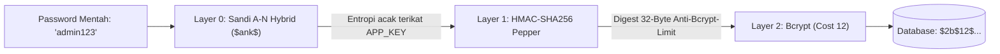

# 📘 Modul 08: Autentikasi & Keamanan

Pakem Framework menyediakan sistem keamanan ganda (**Dual Authentication Suite**) yang mencakup autentikasi berbasis **Session/Cookie** untuk aplikasi web tradisional, serta **JSON Web Token (JWT)** untuk API mobile/frontend modern.

---

## 1. Scaffolding Autentikasi Instan (`canting make:auth`)

Buat modul registrasi, login, logout, dan dashboard siap pakai hanya dengan satu perintah:

```bash
canting make:auth
```
Perintah ini akan secara otomatis membuat:
- Controller: `src/app/controllers/auth_controller.rs`
- Model & Migrasi: `User` model dengan hashing password
- Halaman View Blade: `resources/views/auth/login.blade.rs`, `register.blade.rs`, dan `dashboard.blade.rs`.

> **Catatan:** Untuk starter kit autentikasi & dashboard modern berbasis Tailwind CSS dan Pure Blade dengan proteksi Anti Brute-Force & Audit Trail, gunakan **[Pakem Aurora Starter Kit](./14_pakem_aurora_starter_kit.md)** (`canting aurora:install`).

---

## 2. Tri-Layer Password Hashing & Sandi A-N Hybrid

Pakem menghadirkan inovasi keamanan autentikasi tingkat enterprise melalui **Tri-Layer Password Security Stack**:



### A. Tiga Lapis Pertahanan Mutlak:
1. **Layer 0 (Enhanced Sandi A-N Hybrid)**:  
   Mengombinasikan persandian keraton nusantara (substitusi A-N & inversi angka 0-5), *Cucuk Canting Interleaving* (transposisi pasangan indeks genap-ganjil), dan **Key-Dependent Dynamic Masking** yang diderivasi dari `APP_KEY`.  
   *Keunggulan:* Tanpa `APP_KEY`, peretas mustahil merekonstruksi password sekalipun binary atau algoritmanya di-reverse engineer.
2. **Layer 1 (HMAC-SHA256 Secret Pepper)**:  
   Mengamankan string sandi dengan kunci rahasia aplikasi (`APP_KEY`). Melindungi dari *Rainbow Table* jika database bocor tanpa file `.env`, serta mengatasi batas 72-karakter pada Bcrypt.
3. **Layer 2 (Bcrypt Slow Memory-Hard)**:  
   Algoritma hashing lambat berstandar industri dengan work factor cost 12.

### B. Penggunaan Facade `Hash`
```rust
use pakem::prelude::*;

// 1. Membuat Hash Baru (Otomatis Layer 0 -> Layer 1 -> Layer 2)
let hashed = Hash::make("password_rahasia_123");

// 2. Verifikasi Password Saat Login
let is_valid = Hash::check("password_rahasia_123", &hashed);
if is_valid {
    println!("Password cocok!");
}
```

### C. Multi-Framework Legacy Auth Migration
Saat memigrasikan aplikasi lama dari **Laravel**, **CodeIgniter 3**, atau **PHP Native** ke Pakem, pengguna **TIDAK PERLU** mereset password mereka. Gunakan `Hash::check_with_migration`:

```rust
// Otomatis mendeteksi dialek hash asal (Laravel Bcrypt, CI3 SHA-1, MD5 legacy, atau Pakem Tri-Layer)
let (is_valid, needs_rehash) = Hash::check_with_migration("password123", &user.password);

if is_valid {
    if needs_rehash {
        // Password cocok tapi masih berformat lama (misal Laravel $2y$)
        // Otomatis re-hash ke standar Tri-Layer Pakem secara transparan!
        let new_hash = Hash::make("password123");
        User::query(req.db())
            .where_eq("id", user.id)
            .update_one("password", new_hash)
            .await?;
    }
    // Lanjutkan proses login
}
```

---

## 3. Autentikasi JWT (JSON Web Token)

### A. Model Pengguna Terautentikasi (`AuthUser`)
```rust
use pakem::core::auth::AuthUser;
use pakem::http::auth::{generate_token, validate_token};

// 1. Buat instance AuthUser setelah login sukses (berlaku 24 jam)
let user = AuthUser::new(
    1,                                  // user_id
    "user@example.com".to_string(),     // email
    "admin".to_string(),                // role
    vec!["create_post".to_string()],    // permissions
    24,                                 // masa aktif (jam)
);

// 2. Generate token JWT string
let token = generate_token(&user)?;
```

### B. Memproteksi Endpoint dengan `AuthUser` Extractor
Cukup letakkan `auth_user: AuthUser` di parameter fungsi controller Anda. Pakem akan otomatis memvalidasi header `Authorization: Bearer <token>`:

```rust
use axum::Json;
use pakem::core::auth::AuthUser;

pub async fn profile(auth_user: AuthUser) -> Json<serde_json::Value> {
    Json(serde_json::json!({
        "status": "authorized",
        "user_id": auth_user.sub,
        "email": auth_user.email,
        "role": auth_user.role,
    }))
}
```

---

## 4. Role & Permission Guard (`can`)

Periksa hak akses user menggunakan method `auth_user.can(...)`:

```rust
use axum::http::StatusCode;

pub async fn delete_article(auth_user: AuthUser) -> Result<String, StatusCode> {
    if !auth_user.can("delete_post") && auth_user.role != "admin" {
        return Err(StatusCode::FORBIDDEN);
    }

    Ok("Artikel berhasil dihapus".to_string())
}
```

---

## 5. Direktif Autentikasi di Blade (`@auth`, `@guest`)

Sembunyikan atau tampilkan elemen navigasi berdasarkan status login:

```html
@auth
    <span>Halo, {{ $auth.email }}!</span>
    <form method="POST" action="/logout">
        @csrf
        <button type="submit">Keluar</button>
    </form>
@endauth

@guest
    <a href="/login">Masuk</a>
    <a href="/register">Daftar Akun</a>
@endguest
```

---

## 6. Kunci Enkripsi Aplikasi & Key Generator (`canting key:generate`)

Pakem Framework menggunakan `APP_KEY` berkekuatan CSPRNG 256-bit (Base64) untuk mengamankan data rahasia:
- **Enkripsi Cookie & Sesi**: Memastikan cookie sesi tidak dapat dibaca atau dimanipulasi di sisi browser.
- **HMAC Signatures**: Menandatangani token CSRF, URL S3 bertanda tangan, dan snapshot state Pakem Live.
- **SandiAN Pepper Hashing**: Lapisan perlindungan tambahan terhadap rainbow table attacks pada hash sandi.

```bash
# Menghasilkan dan menyimpan APP_KEY baru ke file .env
canting key:generate

# Menghasilkan APP_KEY sekaligus JWT_SECRET
canting key:generate --jwt

# Menampilkan key ke stdout tanpa mengubah file
canting key:generate --show

# Force generate di lingkungan produksi
canting key:generate --force
```

---

## 7. Pakem Shield Security Audit (`canting audit`)

Sebelum melakukan deployment ke server produksi, Pakem menyediakan alat audit keamanan otomatis:

```bash
canting audit
```

### Lingkup Pemeriksaan Otomatis:
1. **Secret & Key Entropy**: Memverifikasi kekuatan `APP_KEY` dan `JWT_SECRET` (panjang minimal 32 karakter dan bukan placeholder default).
2. **Debug Mode in Production**: Mencegah kebocoran stack trace dan kredensial sensitif jika `APP_DEBUG=true` aktif di lingkungan `production`.
3. **CSRF Protection on Forms**: Memindai seluruh template tampilan (`resources/views/`) untuk memastikan setiap formulir bermetode `POST` memiliki direktif `@csrf`.
4. **Database & Storage Hardening**: Memeriksa koneksi database dan isolasi folder upload publik.
5. **Scoreboard & Actionable Fixes**: Memberikan skor keamanan (*0–100*), peringkat mutu (*Grade A+*), serta rekomendasi perintah perbaikan secara instan.

---

## 8. Ekosistem Keamanan Tingkat Lanjut & Starter Kit

Untuk implementasi keamanan tingkat lanjut dan starter kit siap pakai:
- **[Modul 14: Pakem Aurora Starter Kit](./14_pakem_aurora_starter_kit.md)**: Paket autentikasi & dashboard elegan dengan Pure Blade + Tailwind CSS (`canting aurora:install`).
- **[Modul 15: Enterprise Security & Zero-Panic Safety](./15_enterprise_security_dan_zero_panic.md)**: Zero-Panic Error Boundary (`catch_unwind`), Anti Brute-Force lockout cache, OWASP security headers, dan audit trail ISO 27001.

---

### Navigasi Modul:
- **Sebelumnya**: [Modul 07: Indonesian Script](./07_indonesian_script.md)
- **Berikutnya**: [Modul 09: Broadcasting & WebSocket](./09_broadcasting_dan_websocket.md) ➔
- **Kembali ke**: [Daftar Isi Dokumentasi](./README.md)
